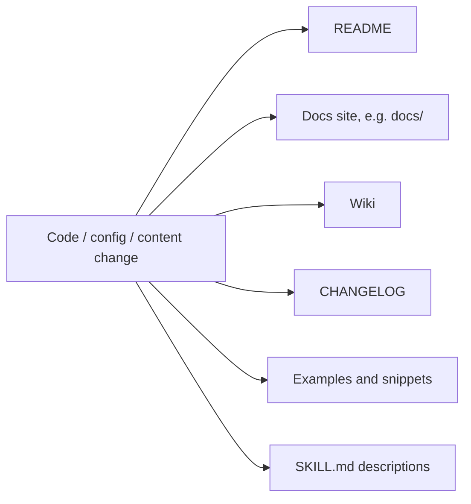

# Docs Sync on Change

**Rule:** documentation ships in the same commit or pull request as the change it documents. A change that leaves the docs wrong is incomplete.

## 1. Check every surface

For each surface, ask: *does this change make any line here wrong, incomplete, or misleading?* If so, update it in the same pull request.

1. **README:** feature list, install steps, usage examples, table of contents.
2. **Docs site:** item lists or cards, version or last-updated stamps. If the site is generated, re-run the generator, and open the result locally to check it renders.
3. **CHANGELOG:** add an entry under `## [Unreleased]` (Keep a Changelog format).
4. **Wiki:** if the project has one and documented behavior changed.
5. **Inline examples:** snippets that use the changed name, flag, or endpoint. Search for them: `git grep -n "<old-name>"`.
6. **Skill descriptions** (in a skills repository): the description must still match what the skill does.

## 2. Keep one source of truth

Don't maintain the same list by hand in several places. Pick one source and generate the rest:

| Repository type | Source of truth | Generated |
|---|---|---|
| Skills library | `SKILL.md` frontmatter | README table, docs site catalog |
| Library | Package exports, type definitions | API reference |
| Service | OpenAPI spec | Endpoint list, client docs |

Put the generator in the repository (for example `scripts/build-docs`), and make CI fail when its output differs from what is committed. [assets/docs-check.yml](assets/docs-check.yml) is a GitHub Actions template for that check.

## 3. Final check before committing

> If a stranger reads only the README and the docs site after this commit, will they get a correct picture? If not, what is missing?

## Anti-patterns

- "I'll update the docs in a follow-up." Same pull request, or it doesn't ship.
- Hand-editing two copies of the same list: they will drift.
- Forgetting a `docs/` folder exists. Check for one at the start of any non-trivial change.
- Updating the docs but not the CHANGELOG.
- A stale "last updated" date. Generate it at build time or from the file's modification date.
