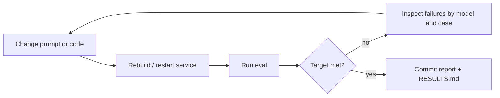

# Eval-Driven Development

For AI output-quality work, the eval is the specification. Write it before (or alongside) the fix, and let it decide when the fix is done.

## 1. Principles

- **Eval first.** Encode the failure as test cases before changing prompts or code. Re-run the full eval after every change.
- **Iterate locally.** Run evals against a local or dedicated dev environment. Use shared environments only for final validation.
- **Cover what users can select.** An eval is not done until it covers every model, provider, or strategy a user can choose for the capability. Failure patterns differ between them.
- **Use an explicit status taxonomy, not just pass/fail** (section 4). Acceptable-but-not-ideal outputs are first-class results.
- **Reproducible reports.** Every run regenerates a report that is committed with the change.
- **Agree the target in advance**, for example 100% acceptable across all models before requesting human review.

## 2. Folder layout

One folder per eval, named for the behavior under test:

```
evals/<eval-name>/
├── README.md          # What this eval tests, how to run it, latest results
├── run_eval.py        # Driver, from assets/run_eval_template.py
├── cases.json         # Test cases: id, input, expected / acceptable / wrong markers
├── report.md          # Auto-generated per-case, per-model report
├── RESULTS.md         # Human-written summary, from assets/results-template.md
└── data/              # Optional raw outputs per run (gitignore if large)
```

Use the project's existing convention (`scripts/`, `tests/evals/`, …) if it has one.

## 3. Test coverage

| Dimension | Default | Rationale |
|---|---|---|
| Cases | Start with 10–20 varied cases | Enough variety to expose patterns; fast enough to run every iteration |
| Models / strategies | All user-selectable ones | Each fails differently |
| Inputs | Every language, format, or domain named in the issue; add one contrasting variant | Fixes for one variant often break another |
| Edge cases | Both polarities of the property, ambiguous inputs, multi-entity inputs | Failures cluster at boundaries |

Small case counts are for fast iteration, not for claims. Before stating that one model or fix is *better*, check the sample size with the `skill-eval-statistics` skill (`scripts/skillstats.py compare` and `ci`). Ten cases per model can show that something is broken, not that a fix is a few points better.

## 4. Status taxonomy

Define statuses that match the property being tested. A three-level scale works for most quality issues:

| Status | Meaning | Example (gender agreement in translation) |
|---|---|---|
| `PASS` | Output has the expected form | Feminine form for a female subject |
| `PASS_NEUTRAL` | Output is acceptable but avoids the property | Gender-neutral phrasing |
| `FAIL` | Output has a wrong form | Masculine form for a female subject |

Report `PASS`, `PASS_NEUTRAL` and `FAIL` separately, and define the headline rate explicitly (for example `(PASS + PASS_NEUTRAL) / total`). A rising neutral share can hide a model that has stopped attempting the task.

## 5. Eval driver

Start from [assets/run_eval_template.py](assets/run_eval_template.py). The driver should:

1. Accept arguments to select models, cases, environment, and output path.
2. Send each case to the service through the same interface users hit.
3. Classify each output deterministically where possible (expected, acceptable and wrong markers per case). Use an LLM judge only where code cannot decide, and calibrate it against human labels first.
4. Print a summary table and write `report.md` with a model × status table and per-case output snippets.
5. Exit non-zero when the agreed target is not met, so the eval can gate CI.
6. Optionally write one JSON line per case and run (`{"query", "variant", "pass"}`) so `skill-eval-statistics` can analyze it.

## 6. Results summary (`RESULTS.md`)

Copy [assets/results-template.md](assets/results-template.md). Report every rate as `k/n` with an interval, list failure patterns by model with case ids, and explain every remaining failure.

Post the summary table on the linked issue or work item, and link to the committed report.

## 7. Iteration loop



Commit the regenerated report with each meaningful change, so the history shows which change moved which results.

## 8. Two-layer fix pattern

When failures span several models, and some of them cannot be steered by prompts (for example, fixed-API translation services), fix in two layers:

1. **Steering layer** (models that accept instructions): extract the needed context in a pre-pass and inject it into the prompt.
2. **Deterministic post-processing** (all models): a function that enforces the property on the output as a safety net. Call it on every code path that returns output, and unit-test it on its own.

The post-processing layer is what makes non-steerable models pass, and it keeps steerable ones from regressing silently.

## 9. Before opening the pull request

- [ ] Lint, format and unit tests pass
- [ ] The full eval was re-run on the final code, and the report is committed
- [ ] `RESULTS.md` explains every remaining failure
- [ ] Results claims include sample sizes and intervals
- [ ] Version bumps or deployment config changes the project requires are done

After merging, re-run the eval against each environment as the change is promoted, and update the issue with the results.

## Anti-patterns

- Tuning prompts against the same few cases you report on: hold some cases back.
- Reporting one blended pass rate across models: it hides the one that fails.
- Declaring victory on a small improvement without checking whether the sample can show it.
- Classifying outputs by eyeballing instead of by recorded criteria.
