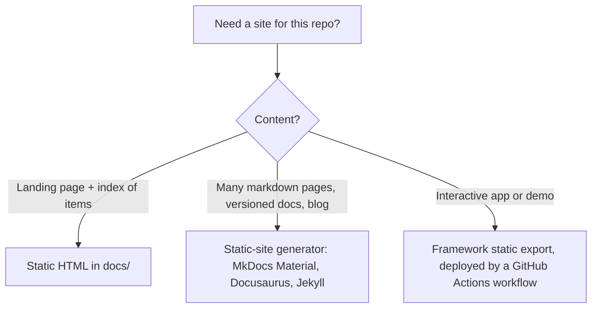

# GitHub Pages Generation

Ship a polished site without a build pipeline unless the content demands one.

## 1. Choose the setup



**Default: static HTML in `docs/`.** No build step, previews by opening the file, no Ruby or Node toolchain.

## 2. Lay out `docs/`

```
docs/
├── index.html       # From assets/index.html
└── assets/
    ├── favicon.svg  # From assets/favicon.svg, recolored
    └── og-image.png # 1200×630 social preview
```

Copy [assets/index.html](assets/index.html) and [assets/favicon.svg](assets/favicon.svg) as the starting point. The template renders its card grid from a JSON block, so a script can regenerate the item list from a single source of truth (see the `docs-sync-on-change` skill).

## 3. Fill in the required parts

1. **Hero:** repository name, one-sentence purpose, a primary call to action (install command or GitHub link).
2. **Card grid:** one card per item, with title, category, one-line description, and a link to its source.
3. **How to use:** copy-pasteable install or usage commands.
4. **Footer:** author, license, repository link, last-updated date.
5. **Meta tags:** `description`, `og:title`, `og:description`, `og:image`, `og:url`, `twitter:card`.
6. **Favicon:** a one-line SVG is enough.
7. **Responsive layout and dark mode:** the template handles both. Check at phone width before publishing.

## 4. Enable Pages

Pick one:

- **Branch deploy:** Settings → Pages → Source: *Deploy from a branch* → `main`, folder `/docs`.
- **Actions deploy:** Settings → Pages → Source: *GitHub Actions*, plus a workflow using `actions/upload-pages-artifact` and `actions/deploy-pages` with `path: docs`. Use this when a build step is needed.

The site appears at `https://<owner>.github.io/<repo>/` within a minute or two. For a custom domain, add `docs/CNAME` containing the domain and point a DNS `CNAME` record at `<owner>.github.io`.

## 5. When to move beyond static HTML

| Need | Use |
|---|---|
| Search across many pages | MkDocs Material or Docusaurus |
| Versioned docs | Docusaurus, or MkDocs with `mike` |
| API reference generated from code | TypeDoc, Sphinx, or Doxygen output |
| Blog | Jekyll or Astro |

## Anti-patterns

- Pasting the whole README into `index.html`: curate instead.
- A generator for a single page.
- Maintaining the item list by hand in both the README and the site: generate one from the other.
- Missing `og:image`: shared links look broken without it.
- Committing build output or `node_modules/` to `main`: build in a workflow instead.
