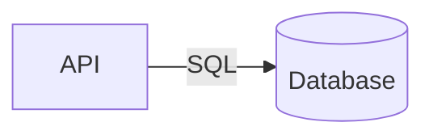

# Mermaid Diagrams

Mermaid renders natively in GitHub, GitLab, Azure DevOps, VS Code preview, and most docs generators. ASCII boxes are hard to edit, inaccessible to screen readers, and never render as images. **Use Mermaid for every diagram in Markdown.**

## 1. Replace ASCII art

Instead of:

```
+-----+      +----+
| API | ---> | DB |
+-----+      +----+
```

write:

````markdown

````

## 2. Pick the diagram type

| Showing | Type | Keyword |
|---|---|---|
| Components and data flow | Flowchart | `flowchart LR` |
| Ordered interactions over time | Sequence | `sequenceDiagram` |
| Lifecycle of one thing | State | `stateDiagram-v2` |
| Data model | Entity-relationship | `erDiagram` |
| Type relationships | Class | `classDiagram` |
| Timeline (sparingly) | Gantt | `gantt` |

Examples of each, ready to adapt, are in [references/diagram-types.md](references/diagram-types.md).

## 3. Style rules

- **One diagram, one idea.** Split architecture, sequence, and state into separate diagrams.
- **Label edges** with the verb or protocol: `-->|HTTPS|`, `-->|enqueue|`, `-->|writes|`.
- **Use shape meaning consistently:** `[Rectangle]` service or process, `[(Cylinder)]` data store or queue, `((Circle))` actor or start, `{Diamond}` decision.
- **Show trust boundaries** with `subgraph`.
- **Short node IDs, descriptive labels:** `DB[(Orders database)]`.
- Use `flowchart`, not the older `graph` keyword. Prefer `LR` for architecture.

## 4. Check before committing

Preview the Markdown (GitHub preview, VS Code preview, or the [Mermaid live editor](https://mermaid.live)). A syntax error renders as an error box, not a diagram.

If a target renderer lacks Mermaid support, export the diagram to SVG and commit both the source and the image. Don't fall back to ASCII.

## 5. Migrating existing ASCII diagrams

1. Read what the diagram communicates.
2. Pick the matching type from section 2.
3. Replace the ASCII block with a `mermaid` block, keeping the surrounding prose.
4. Preview it.

## Anti-patterns

- New ASCII box diagrams in Markdown.
- One giant flowchart showing every component, call, and state.
- Unlabeled arrows.
- Screenshots of diagrams when Mermaid source would do.
- Forcing Mermaid where it is weak (pixel-precise layouts, freeform sketches): use a drawing tool and commit the exported image.
