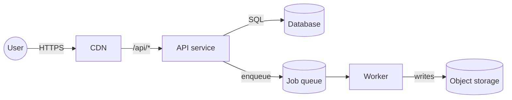
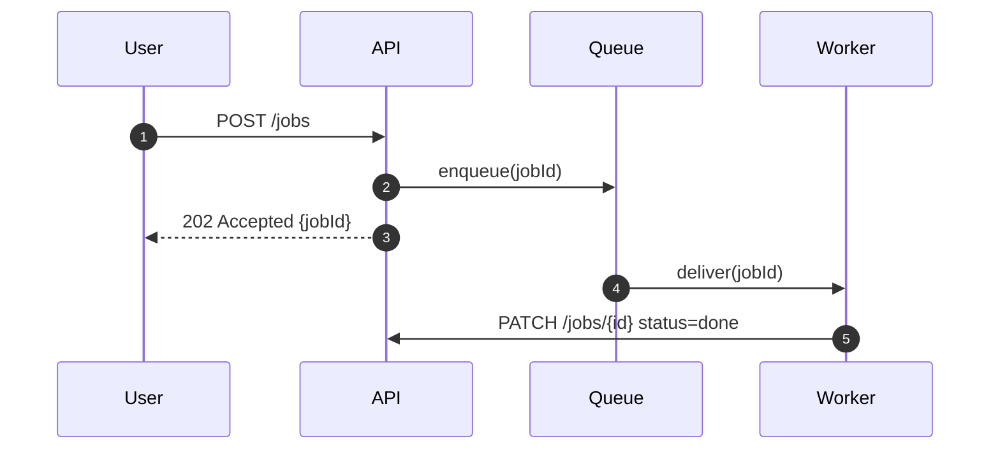
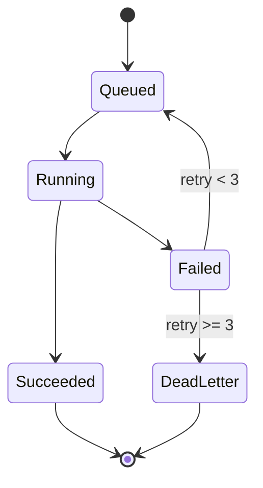
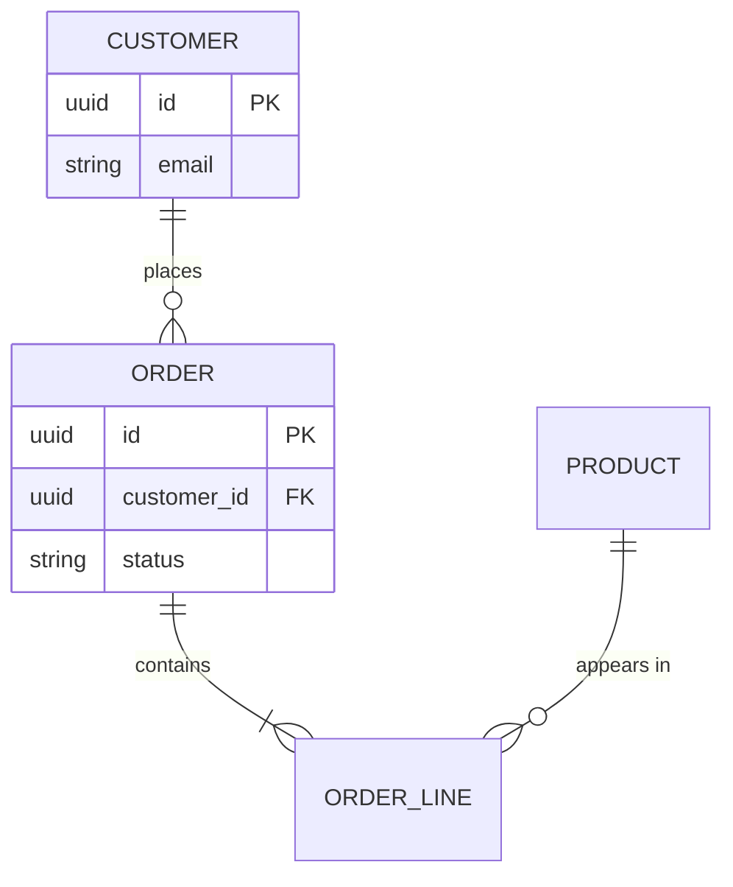
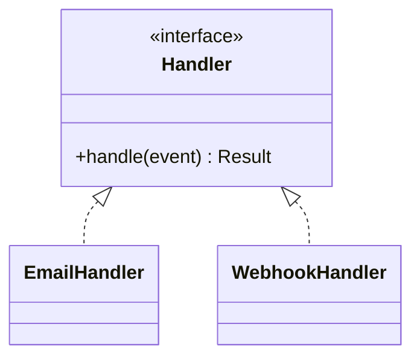
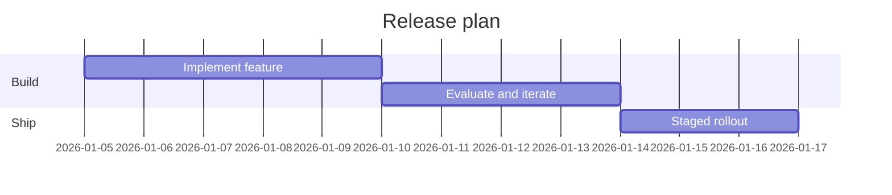
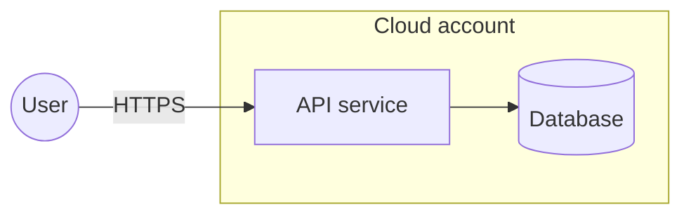

# Mermaid diagram types: examples

## Contents

- [Flowchart](#flowchart)
- [Sequence](#sequence)
- [State](#state)
- [Entity-relationship](#entity-relationship)
- [Class](#class)
- [Gantt](#gantt)
- [Trust boundaries with subgraph](#trust-boundaries-with-subgraph)

## Flowchart

Components and data flow. `LR` reads left to right; `TB` top to bottom.

## Sequence

Use when order matters. `autonumber` helps in long sequences.

## State

Lifecycles and retries.

## Entity-relationship

## Class

## Gantt

Use sparingly; plans change faster than diagrams.

## Trust boundaries with subgraph

