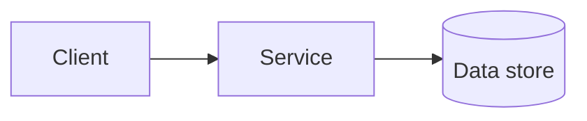

# <NNNN> — <Feature name>

**Status:** Draft | In review | Accepted | Implemented | Superseded by <NNNN> | Rejected
**Author:** <name>  **Date:** <YYYY-MM-DD>  **Reviewers:** <names>
**Related:** <issue / work item / other specs>

## Problem

<!-- Who has the problem, why now, with concrete examples. -->

## Goals

- <Specific, measurable outcome>

## Non-goals

- <Explicitly out of scope>

## Constraints

- <Deadlines, budgets, compliance, systems that must not break>

## Proposed design

### Architecture

### Data model

<!-- Tables, fields, relationships, migrations, indexes. -->

### API / interface

<!-- Request and response shapes, error codes, backward compatibility. -->

### Failure modes

<!-- What happens when each dependency fails: retries, timeouts, idempotency. -->

## Threat model

<!-- Required. Fill in from threat-model.md. -->

## Alternatives considered

1. **<Alternative A>:** <one paragraph>. Rejected because <reason>.

## Rollout

<!-- Feature flag? Phased? Backfill? Rollback plan? -->

## Open questions

- [ ] <Question that must be answered before implementation>

## Test plan

<!-- Unit, integration, eval, and manual tests that show it works. -->

## Success metrics

<!-- How we will know it worked after launch: concrete numbers or signals. -->
